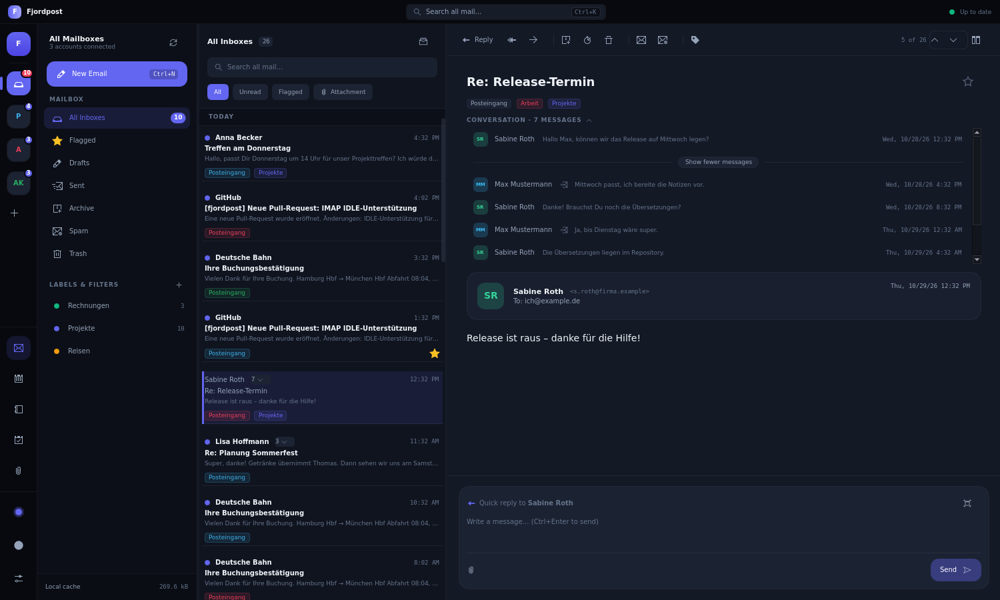

# Fjordpost

Ein moderner E-Mail-Client für KDE Plasma im Stil von Mailbird – mit eigener,
schneller Mail-Engine statt Akonadi.

C++20 · Qt 6 · KDE Frameworks 6 · Kirigami · SQLite



> **Entwicklungsstand:** Fjordpost ist noch nicht für den Alltag gedacht. Bitte nur mit
> Testkonten oder einem eigenen Datenverzeichnis (`--data-dir`) ausprobieren.

## Funktionen

**Mail**
- IMAP mit Hintergrund-Abgleich, IDLE (Push) und Offline-Betrieb: Aktionen wirken sofort
  lokal und werden nachgereicht, sobald der Server erreichbar ist
- Eigener SMTP-Client (STARTTLS/SSL, AUTH PLAIN/LOGIN/XOAUTH2) mit Postausgang
- Kontoeinrichtung mit automatischer Servererkennung (Anbieter-Konfiguration,
  Thunderbird-ISPDB, MX-Einträge)
- Gemeinsamer Posteingang aller Konten, Volltextsuche (`Strg+K`), Schnellfilter
- Konversationen: gruppiert in der Liste (aufklappbar) und als Verlauf im Lesebereich
- Labels über alle Konten, auf dem Server als IMAP-Schlüsselwörter gespeichert
  (kompatibel mit gleichnamigen Thunderbird-Tags)
- Composer im Hauptfenster oder als eigenes Fenster, Antworten/Weiterleiten, Anhänge,
  Schnellantwort im Lesebereich
- Signaturen je Konto, „Senden rückgängig“ (einstellbar)
- HTML-Mails mit blockierten externen Inhalten (auf Wunsch nachladbar)

**KDE-Integration**
- Passwörter in KWallet (über QtKeychain), nie in Datei oder Datenbank
- Benachrichtigungen, Symbol im Systemabschnitt, Zähler in der Taskleiste
- Eigenes dunkles bzw. helles Design mit wählbarer Akzentfarbe – oder das
  KDE-Farbschema des Systems

## Fahrplan

| Meilenstein | Inhalt | Stand |
|---|---|---|
| M0 | Grundgerüst, Datenbank, Oberfläche mit Demo-Daten | ✅ |
| M1 | IMAP + SMTP, Kontoeinrichtung, Lesen/Schreiben | ✅ |
| M2 | Signaturen, Senden rückgängig, Konversationen, Labels, Snooze, Filterregeln, POP3, Import/Export | in Arbeit (die ersten vier ✅) |
| M3 | CardDAV / CalDAV: Kalender, Kontakte, Aufgaben, Einladungen | geplant |
| M4 | Google (OAuth2 für Gmail, Kontakte, Kalender) | geplant |
| M5 | OpenPGP + S/MIME | geplant |
| M6 | Übersetzungen, Feinschliff, Pakete (Flatpak, PKGBUILD) | geplant |

## Bauen

Abhängigkeiten unter Debian 13 (auch WSL2) installiert ein Skript:

```sh
sudo dev/install-deps-debian.sh
cmake -B build -G Ninja -DCMAKE_BUILD_TYPE=Debug
cmake --build build
ctest --test-dir build --output-on-failure
```

Benötigt werden u. a. Qt 6 (Quick, WebEngine, Sql), KDE Frameworks 6 (Kirigami,
I18n, Notifications, DBusAddons, StatusNotifierItem), KIMAP, KMime und QtKeychain.

Starten mit Beispieldaten in einem eigenen Datenverzeichnis, damit echte Daten
unberührt bleiben:

```sh
build/bin/fjordpost --demo --offline --data-dir /tmp/fjordpost-demo
```

### Entwickleroptionen

| Option | Zweck |
|---|---|
| `--demo` | leere Datenbank mit Beispielkonten und -mails füllen |
| `--offline` | keine Serververbindungen |
| `--data-dir <dir>` | eigenes Datenverzeichnis |
| `--screenshot <png>` | Fenster nach 3 s als Bild speichern und beenden |
| `--dev-action <aktion>` | vor dem Screenshot eine Aktion auslösen, z. B. `open-first`, `compose`, `settings`, `expand-thread` (vollständige Liste: `fjordpost --help`) |

## Testserver

Für Tests ohne echte Konten gibt es einen lokalen Mailserver (GreenMail):

```sh
sudo docker compose -f dev/docker-compose.yml up -d
```

In Fjordpost ein Konto `max@fjordpost.test` (Passwort `geheim`) anlegen und nach
„Weiter“ die Server von Hand eintragen: IMAP `localhost:3143`, SMTP `localhost:3025`,
jeweils ohne Verschlüsselung. Mails an `anna@fjordpost.test` landen im zweiten Testkonto.

Der Integrationstest läuft gegen denselben Server:

```sh
FJORDPOST_TEST_SERVER=127.0.0.1 build/bin/servertest
```

## Tastenkürzel

| Taste | Aktion |
|---|---|
| `Strg+K`, `Strg+F` oder `/` | Suche |
| `↑` / `↓`, `J` / `K` | Nächste / vorherige Nachricht |
| `E` | Archivieren |
| `Entf` | Löschen |
| `S` | Markieren (Stern) |
| `U` | Als ungelesen markieren |
| `L` | Labels |
| `Strg+N` | Neue Nachricht |
| `Strg+R` / `Strg+Umschalt+R` | Antworten / Allen antworten |
| `Strg+L` | Weiterleiten |
| `Strg+Enter` | Senden (im Composer) |
| `F5` | Abrufen |

## Aufbau

| Verzeichnis | Inhalt |
|---|---|
| `src/core` | Konten, Geheimnisse (KWallet über QtKeychain) |
| `src/storage` | SQLite mit Migrationen und FTS5-Volltextsuche, Ablage der Roh-Mails, Labels |
| `src/mail` | IMAP-Abgleich, SMTP-Client, MIME, automatische Servererkennung |
| `src/models` | Qt-Modelle für die Oberfläche |
| `src/integration` | App-Controller, Kontoeinrichtung, Benachrichtigungen |
| `src/qml` | Kirigami-Oberfläche |
| `tests` | QtTest, IMAP gegen einen simulierten Server, Integrationstest gegen GreenMail |

Hinweise für Mitwirkende (Konventionen, Fallstricke, Architektur im Detail) stehen in
[AGENTS.md](AGENTS.md).
